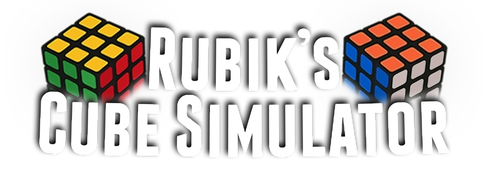

Play it on Itch.io: https://giansob.itch.io/rubiks-cube-simulator

Project documentation: [English slideshow](utils/docs/Presentazione%20Rubik's%20Cube%20Simulator%20-%20ENG.pdf) and [Italian slideshow](utils/docs/Presentazione%20Rubik's%20Cube%20Simulator%20-%20IT.pdf)

# RubikSimulator

RubikSimulator is a digital Rubik's Cube that runs in 3D on your PC. You can:

- Solve the cube with the mouse or the keyboard
- Watch standard moves with smooth animations
- Inspect the cube from any angle, with an optional auto-rotating camera
- Time your solves and track personal bests
- Ask a built-in solver for a hint when you get stuck
- Earn achievements and unlock cube skins
- Compete on the global leaderboard with players around the world

## Features

### Game modes

- Free play: practice without a clock. Scramble at any time with `X`.
- Easy, medium, hard: timed solves from scrambles of increasing difficulty.
- Limited time: solve before the clock runs out (1, 5, 10 or 15 minutes).
- Limited moves: solve within a move budget (15 to 50 moves).
- Daily cube: one shared scramble per day (UTC), with its own leaderboard and streak achievements.

Each mode has its own skybox background. You can also use a solid gradient in the mode's color instead.

### Hints and undo

- Hints: after 30 seconds without a move, a banner suggests the next move and a 3D arrow points to it. You can turn hints off in Settings.
- Undo: `Z` takes back your last move.
- Camera: orbit with the right mouse button or the arrow keys, reset with `T`, and toggle auto-rotate with `Space`.

### Achievements and customization

- 44 achievements across beginner, speed, efficiency, progression, challenge, daily, mastery and secret categories.
- 16 cube skins, such as Cotton Candy, Checkmate, 8-Bit, Neon Nights, Hologram and Magma Core. Each skin unlocks through an achievement. Pick the active skin on the Customization page.
- A popup appears in the game when you earn an achievement.

### Statistics

The Statistics page shows your personal bests for time, moves and TPS (turns per second) in every mode.

### Global leaderboard

Your records sync to a global leaderboard:

- Separate boards for each timed mode (easy, medium, hard, limited time, limited moves) and for the daily cube
- Regional filters: Europe, Americas, Asia, Oceania and Africa
- A username and region, set on your profile
- Automatic cloud sync of your records
- If there is no internet connection or the database cannot be reached, an error banner appears. Your records are still saved on this PC.

### Settings

- Display: windowed, borderless or fullscreen, with monitor and resolution choices. HDR, with brightness control, is available when your monitor supports it.
- Graphics: anti-aliasing, VSync (off by default), an FPS counter, and background style and stars.
- Audio: master, music, sound effect and menu volumes.
- Accessibility: color schemes for red-weak, green-weak and blue-weak vision (Protanopia, Deuteranopia, Tritanopia).

### Controls

| Action | Input |
| --- | --- |
| Turn a layer | Left-drag on a face, or `R` `L` `U` `D` `F` `B` (add `Shift` to reverse) |
| Slice turns | `M` (middle), `E` (equator), `S` (standing), add `Shift` to reverse |
| Orbit the camera | Right-drag, or arrow keys |
| Undo last move | `Z` |
| Scramble (Free Play) | `X` |
| Auto-rotate camera | `Space` |
| Reset camera | `T` |
| Open or close the menu | `Esc` |
| Toggle fullscreen | `F11` |
| Debug view | `Ctrl` + `B` |

## Run from source

Install the packages in [utils/requirements.txt](utils/requirements.txt) (pygame, pygame-menu, PyOpenGL and NumPy), then start the game:

```bash
pip install -r utils/requirements.txt
python src/main.py
```

Settings, achievements, personal bests and your profile are stored in `%APPDATA%\RubiksCubeSimulator\`.

## Technologies

- Language: Python, for the cube logic, moves, solver and interface.
- Rendering: Pygame and OpenGL (PyOpenGL) for 3D, with HDR output and custom shaders for the skins.
- Menus: pygame-menu.
- Solver: a Kociemba two-phase solver (`src/pykociemba`). It runs in its own process, so it does not slow the frame rate.
- Backend: [Supabase](https://supabase.com/) for the leaderboards, user profiles and record sync.

## Project structure

```
src/
  main.py              Entry point
  rubiks_cube.py       Cube state, color schemes
  cube_skins.py        Skin definitions and unlock rules
  solver.py            Hint solver process
  game/                Game loop, moves and scrambles, HUD, hints, display
  managers/            Settings, achievements, personal bests, users, Supabase
  rendering/           OpenGL renderer, backgrounds, HDR, display management
  ui/                  Menus (main, settings, stats, customization...) and UI style
  pykociemba/          Kociemba solver and pruning tables
utils/                 Icons, sounds, soundtrack, documentation, requirements
```

## Credits

Developed as a school project by two programmers.

In-game credits:

- Gianluca Soban: sound designer and developer
- Leonardo Malannino: developer
